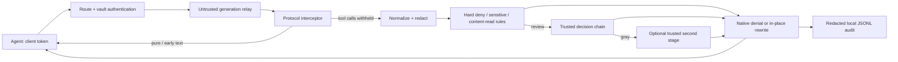

# auto-mode-proxy

[简体中文](README.zh-CN.md) · [Configuration](docs/config.md) · [Threat model](docs/threat-model.md) · [Compatibility evidence](docs/compat.md)

A tool-use safety gateway between coding agents and an **untrusted model relay**. It inspects supported Anthropic Messages, OpenAI Responses and Chat Completions generation responses before executable tool calls reach the client, using local rules and a separately trusted decision-provider chain. It is **not a sandbox**, and neither a model verdict nor a gateway connection proves that an agent is safe.

## One-minute connection: init → serve → agent

Prerequisites: Node **`^24.11.0 || >=26.0.0`** (Node 25 is excluded), npm **12+**, an installed agent, an authorized relay/model, and a separately trusted decision-provider account. Paid provider calls require your authorization. The source setup defaults to Anthropic/OpenAI first-party generation endpoints and OpenRouter `typesafe/jev-1.14` for decisions; that endpoint/model combination is **setup guidance, not live-verified compatibility**. Use `init` interactively to choose different credential-free base URLs and the decision model, or edit the generated YAML using the [reference](docs/config.md).

### 1. Obtain the CLI without assuming a public release

Public npm package/tag and GHCR image availability have **not** been established. Bootstrap from this repository; the following commands are for a POSIX shell. Start in a trusted checkout:

```sh
npm ci
npm run build
PACK_FILE=$(npm pack --json | node --input-type=module -e '
let text = "";
for await (const chunk of process.stdin) text += chunk;
const entry = Object.values(JSON.parse(text)).find(value => value.name === "auto-mode-proxy");
if (!entry || typeof entry.filename !== "string") process.exit(1);
process.stdout.write(entry.filename);
')
SOURCE_DIR=$PWD
CLIENT_DIR=$(mktemp -d)
cp "$SOURCE_DIR/$PACK_FILE" "$CLIENT_DIR/$PACK_FILE"
cd "$CLIENT_DIR"
npx --yes "./$PACK_FILE" --version
npm install --no-save "./$PACK_FILE"
```

npm 12's `pack --json` output is a **name-keyed object**, not the older array. The archive filename is taken from that output, not a guessed version or an unexpanded glob. Run `npx` against the **relative `./filename.tgz` inside the clean directory**; an absolute archive path may be dispatched as a command instead. The local installation gives subsequent terminals the stable `./node_modules/.bin/auto-mode-proxy` command.

**Only after a release is actually published**, `npm install --global auto-mode-proxy` and `auto-mode-proxy ...` are alternatives. Likewise `ghcr.io/evegoodevening/auto-mode-proxy:<published-tag>` is a post-release name, not a promise that a tag exists. [Deployment files](deploy/) require your owned domain, authorized host/DNS/TLS and privately provisioned configuration; public HTTPS acceptance is still separate.

### 2. Initialize and start the private local gateway

From the clean directory above:

```sh
umask 077
./node_modules/.bin/auto-mode-proxy init --yes --config ./config.yaml
```

`init` writes a private file, issues a fresh client token, and intentionally prints it in the setup snippets. **Keep the output private**; do not pipe it into shared logs. It refuses an existing file unless you explicitly pass `--force`; symlink destinations are rejected. The file contains literal `${RELAY_A_KEY}`, `${RELAY_B_KEY}` and `${OPENROUTER_API_KEY}` references. All three must be defined even if you initially use only Claude, because configuration loading resolves the whole file.

Privately replace these **fake example values** with your authorized credentials in the server terminal (do not commit credentials or retain them in shell history). The fake values below cannot authenticate to real providers:

```sh
export RELAY_A_KEY='example-only-anthropic-key'
export RELAY_B_KEY='example-only-openai-key'
export OPENROUTER_API_KEY='example-only-decision-key'
./node_modules/.bin/auto-mode-proxy serve --config ./config.yaml
```

Leave that terminal running. Default binding is `127.0.0.1:8484`, vault authentication, **enforce**, provider-failure **block**. `serve` accepts `--config <path>` and `--log-level <level>`; there is no serve host/port flag—edit `listen` instead. `check --config ./config.yaml` validates configuration **and makes a potentially billed canary request to every configured decision provider**; it is not an offline validation flag. Missing ENV or invalid configuration fails rather than silently falling back to another key.

### 3. Connect an agent

Use a second terminal. Copy the **issued client token from init** into the relevant example; do not use the relay/decision key. Values in angle brackets are operator substitutions, never literal working credentials. Select a model actually supported by your relay. Keep the client's normal approval/sandbox controls.

#### Claude Code CLI

```sh
export ANTHROPIC_BASE_URL='http://127.0.0.1:8484/cc'
export ANTHROPIC_AUTH_TOKEN='<issued client token>'
export ANTHROPIC_API_KEY=""
# Recommended gateway metadata hints (not proof of native capability):
export CLAUDE_CODE_GATEWAY_HINT_HEADERS=1
# Optional classifier cost hint; requires a configured trusted classifier route:
export CLAUDE_CODE_AUTO_MODE_MODEL=claude-haiku-5-5
claude --print --tools '' --model '<relay-supported-model>' 'Reply with AMP_ONBOARDING_OK only.'
```

A successful response is a **tool-free connection check**, not enforcement, native delivery, cache or real-provider accuracy acceptance. For ordinary interactive work run `claude --model '<relay-supported-model>'` in your intended workspace. Optional `CLAUDE_CODE_AUTO_MODE_MODEL=claude-haiku-5-5` is only a classifier-cost hint; first configure a trusted `decision.second_stage` and enable `classifier_reroute` before relying on classifier isolation. Minimal `init` does not do that.

**Claude Code 2.1.311:** native proxy wire order was correct, but actual immediately-following client replay reversed mixed content and lost one exact denial reason; strict native acceptance **FAILED**. Exact-version rewrite was independently demonstrated with local mocks. For that version add `claude_delivery_by_version: { '2.1.311': rewrite }` to the `/cc` route before serving, or explicitly choose route-wide `claude_delivery: rewrite`. Neither is proof of scoped automatic fallback. Preserve the [complete negative evidence and setup details](docs/agents/claude-code.md). Claude Desktop does **not** read `ANTHROPIC_BASE_URL`; its separately exercised Linux managed-gateway recipe is in that guide.

#### Codex CLI / Desktop configuration

Export `AMP_TOKEN='<issued client token>'` privately in the process environment. Merge this **TOML** into the intended `~/.codex/config.toml` (preserve other settings; top-level entries must be before any table):

```toml
model = "<relay-supported-direct-tool-model>"
model_provider = "amp"

[model_providers.amp]
name = "auto-mode-proxy"
base_url = "http://127.0.0.1:8484/codex/v1"
env_key = "AMP_TOKEN"
wire_api = "responses"
supports_websockets = false
```

Codex **0.164.0 is Responses-only**; do not use `wire_api = "chat"` or deprecated `--full-auto`. Start `codex` with normal local safeguards (`--ask-for-approval on-request` or `never` are approval-policy choices, not sandbox settings). `--approve-for-me` and `--yolo` are distinct supported modes; the latter disables local sandbox/approval protection and is **not recommended for onboarding**. Native direct tools include `exec_command` and `write_stdin`; unassociated stdin sessions/alternate execution contexts fail closed. Code-mode JavaScript `exec` is not a shell alias and is unsupported/blocked. Choose an actual direct-tool catalog model; a configuration flag alone does not override native model metadata. Desktop must separately receive the token/configuration and complete its own GUI onboarding; CLI mock evidence does not establish Desktop acceptance. See the [Codex guide](docs/agents/codex.md).

#### WorkBuddy custom model

In **Settings → Models → Add model → Custom**, use:

| Setting | Value |
| --- | --- |
| Full Chat Completions URL | `http://127.0.0.1:8484/workbuddy/v1/chat/completions` |
| API Key | issued client token, without a `Bearer ` prefix |
| Model | actual relay-supported tool-calling model ID |
| Tool calling | enabled |

Confirm that the client sends that complete endpoint without duplicating `/chat/completions`. The original acceptance target is **AI 智能审批 = 自动审批**, not **完全访问 / Full Access**; its availability in the target native version is **unobserved**. Current public permissions documentation does not establish that mode; do not select Full Access to work around it. Exact official Linux x64 DEB/RPM URLs returned 404 in scoped metadata retrieval; that is **not** a claim that Linux is unsupported. Native GUI, authentication, auxiliary headers, approval-mode and ≥5-turn acceptance remain unverified. See the [WorkBuddy guide](docs/agents/workbuddy.md).

## Architecture and enforcement boundary



Hard-deny/unavailable-execution/truncated-write blocks come first, then sensitive-path checks, **known content-read approval**, bounded metadata/management exemptions and genuine `other` direct allow, then provider review. Ordinary `cat`, native Read/Grep and similar content access require approval even inside a project; an apparently approving user phrase is not a deterministic exemption. Metadata-only fast paths remain bounded, not arbitrary read-only programs. Gray results without a reviewer block; invalid/ambiguous reviewer verdicts block. Provider availability failures default to block. `gate.on_provider_failure: allow` deliberately weakens that availability boundary; it does not override structural hard blocks. **Shadow does not protect:** it forwards original bytes without waiting for hypothetical decisions.

Genuine generic `other`, explicit `tool_map: other`, and Task/Todo management exemptions retain direct-allow semantics. Visible execution/content-read clues cannot be erased by mapping, but hidden capabilities, wrong mappings and invisible Task delegation remain residual risks. Trust the client, executable search path and tool definitions; retain OS sandbox/least privilege. The gateway cannot inspect client filesystem symlinks or guarantee that an approved command has no side effects.

Only supported generation endpoints have tool enforcement; opaque paths/metadata/errors are not a protected execution channel. Enforce rejects untrusted generation redirects. Pure/early text is not globally buffered; Anthropic/Responses stateful content after the first withheld execution can wait to preserve order. Whole-turn identity checks precede execution release. Bounded retention is 1 MiB per tool/incomplete SSE frame, 8 MiB total with a 4 MiB reasoning subset; collection/idle/decision deadlines are 60/30/60 seconds. Overflow, malformed data, unfinished EOF and cancellation never justify flushing unapproved execution.

## Privacy, cost and evidence

By default, review sends redacted command/path/write excerpt, the actual last user request and explicitly trusted workspace context to **third-party decision providers**; second-stage gray review adds another provider call. Known configured secrets and recognized credential patterns are redacted, but arbitrary private content is not guaranteed removable. The main relay still sees the original conversation under its own terms. Review [data flows and ZDR differences](docs/threat-model.md#privacy-and-zero-data-retention): Vercel ZDR with first-party routing is an option; OpenRouter ZDR and shared first-party Anthropic pinning conflict; Cloudflare ZDR covers eligible **Unified Billing with Cloudflare-managed credentials only**, not generic BYOK/passthrough, and logging is separate.

**Illustrative estimates**, not quotes or observed billing: approximately **$0.003 per 100 decisions** and **$0.0002 per gray second-stage review**. Workload size, provider/model prices, gateway fees, fallback/retries and review rate change totals; deterministic/cache hits add no new provider call. Use the [manual UTC daily audit aggregation](docs/tuning.md#reading-audit-records-and-utc-daily-estimates): unknown usage/prices/retry charges remain **`null`**, not zero; record and stage subtotals overlap and must not be added. Its historical local mocked example demonstrates accounting only, not an actual provider bill.

Current local safety/package/container evidence is not a public release, real-provider accuracy or native-client-wide guarantee. Rules-only **offline-safety can pass while numerical accuracy fails**; raw uncertainty/effective false blocks and full label denominators remain visible. Release requires fresh whole-corpus/all-configured-provider plus ordered-chain accuracy and independently authorized trusted-run provenance, not a skipped provider job or mocked/rules-only report. See [tuning](docs/tuning.md), [evaluation contract](eval/README.md), and the [versioned compatibility matrix](docs/compat.md) for measured evidence and remaining blockers. Public HTTPS and new-user README connection acceptance must be observed separately.

## Reference

- [All configuration fields and conditions](docs/config.md), including YAML/JSON loading, policy replacements, trusted classifier routing and privacy settings.
- [Threat model, non-goals and trust assumptions](docs/threat-model.md).
- Agent guides: [Claude](docs/agents/claude-code.md), [Codex](docs/agents/codex.md), [WorkBuddy](docs/agents/workbuddy.md).
- `auto-mode-proxy --help` / `<command> --help`: `init`, `serve`, `check`, `token new`, `audit tail`, `eval`. `token new` prints a secret; it does not automatically edit the configuration.

MIT licensed. No manual approval UI, multi-tenant isolation, local execution sandbox, Cloudflare Workers runtime or hook-based integration is provided.
