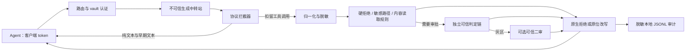

# auto-mode-proxy

[English](README.md) · [完整配置](docs/config.md) · [威胁模型与隐私](docs/threat-model.md) · [兼容性证据](docs/compat.md)

部署在编程 agent 与**不可信模型中转站**之间的工具调用安全网关。在 Anthropic Messages、OpenAI Responses、Chat Completions 支持的生成响应中，工具执行调用到达客户端前，先经过本地规则和独立可信判定提供方审批。它**不是沙箱**；模型判定或连接成功都不代表 agent 已获得全面安全保障。

## 一分钟接入：init → serve → agent

前提：Node **`^24.11.0 || >=26.0.0`**（不含 Node 25）、npm **12+**、已安装的目标 agent、经授权可用的 relay/模型，以及独立可信判定提供方账户。付费调用需要你的授权。默认初始化使用 Anthropic/OpenAI 第一方生成端点、OpenRouter `typesafe/jev-1.14` 判定；这些是**配置指引，不是实测可用的端点/模型声明**。需要其他端点时交互运行 `init`，填写不含凭证的 base URL 与判定模型，或按[参考](docs/config.md)修改生成的 YAML。

### 1. 不依赖已公开发布的本地 CLI

尚未证明 npm 公共包/tag 或 GHCR 镜像已经发布。先从可信源码 checkout 构建；以下为 POSIX shell 命令：

```sh
npm ci
npm run build
PACK_FILE=$(npm pack --json | node --input-type=module -e '
let text = "";
for await (const chunk of process.stdin) text += chunk;
const entry = Object.values(JSON.parse(text)).find(value => value.name === "auto-mode-proxy");
if (!entry || typeof entry.filename !== "string") process.exit(1);
process.stdout.write(entry.filename);
')
SOURCE_DIR=$PWD
CLIENT_DIR=$(mktemp -d)
cp "$SOURCE_DIR/$PACK_FILE" "$CLIENT_DIR/$PACK_FILE"
cd "$CLIENT_DIR"
npx --yes "./$PACK_FILE" --version
npm install --no-save "./$PACK_FILE"
```

npm 12 的 `pack --json` 实际输出是**以名称为键的对象**，不是旧版数组。文件名取自输出，不猜版本、不把未展开的 glob 当路径。必须在干净目录内对**相对路径 `./文件名.tgz`**运行 npx；绝对压缩包路径可能被当作命令执行。随后本地安装的 `./node_modules/.bin/auto-mode-proxy` 可在第二个终端中继续使用。

**仅在实际发布后**，才可改用 `npm install --global auto-mode-proxy` 与 `auto-mode-proxy ...`。同理，`ghcr.io/evegoodevening/auto-mode-proxy:<published-tag>` 是发布后的镜像名称，不表示某个 tag 已存在。[部署文件](deploy/)需要自有域名、获授权的主机/DNS/TLS、私有配置；公网 HTTPS 验收单独记账。

### 2. 初始化并启动私有本地网关

在上述干净目录运行：

```sh
umask 077
./node_modules/.bin/auto-mode-proxy init --yes --config ./config.yaml
```

`init` 创建私有文件、签发随机客户端 token，并**有意把 token 打印在接入片段中**。请勿保存到共享日志。已有文件默认拒绝覆盖；明确使用 `--force` 才替换普通文件，符号链接目标始终拒绝。生成文件保留字面 `${RELAY_A_KEY}`、`${RELAY_B_KEY}`、`${OPENROUTER_API_KEY}`；即使只用 Claude，也必须提供三个变量，因为加载器会解析整份配置。

在服务端终端中私下将以下**假示例值**替换为获授权的真实凭证；勿提交凭证或留在 shell 历史中。以下假值无法通过真实提供方认证：

```sh
export RELAY_A_KEY='example-only-anthropic-key'
export RELAY_B_KEY='example-only-openai-key'
export OPENROUTER_API_KEY='example-only-decision-key'
./node_modules/.bin/auto-mode-proxy serve --config ./config.yaml
```

保持该终端运行。默认监听 `127.0.0.1:8484`，采用 vault、**enforce**、提供方失败 **block**。`serve` 支持 `--config <path>`、`--log-level <level>`，没有 host/port 命令行覆盖，需修改 `listen`。`check --config ./config.yaml` 不只是离线校验：它会向**每个配置的判定提供方发送可能计费的 canary**。缺少 ENV 或配置非法时失败，不会偷偷采用其他 key。

### 3. 连接 agent

打开第二个终端。将对应示例中的 token 换成 **init 签发的客户端 token**，不是 relay/判定 key。尖括号内容是操作员替换项，不是可用凭证。模型必须由实际 relay 支持；保留客户端原有 sandbox 与审批保护。

#### Claude Code CLI

```sh
export ANTHROPIC_BASE_URL='http://127.0.0.1:8484/cc'
export ANTHROPIC_AUTH_TOKEN='<issued client token>'
export ANTHROPIC_API_KEY=""
# Recommended gateway metadata hints (not proof of native capability):
export CLAUDE_CODE_GATEWAY_HINT_HEADERS=1
# Optional classifier cost hint; requires a configured trusted classifier route:
export CLAUDE_CODE_AUTO_MODE_MODEL=claude-haiku-5-5
claude --print --tools '' --model '<relay-supported-model>' 'Reply with AMP_ONBOARDING_OK only.'
```

收到正常回答仅证明**无工具连接检查**成功，不是工具拦截/native/缓存/真实判定准确率验收。在预期工作区进行普通交互可运行 `claude --model '<relay-supported-model>'`。可选 `CLAUDE_CODE_AUTO_MODE_MODEL` 只是 classifier 成本提示；依赖可信 classifier 隔离前，先配置 `decision.second_stage` 并启用 `classifier_reroute`。最小 `init` 不启用改道，该变量也不能代替配置。

**Claude Code 2.1.311 已知限制：**代理 native wire 顺序正确，但紧接着的真实客户端历史回放仍将 mixed 内容反序，并丢失一次完整拒绝原因，严格 native 验收 **FAILED**。精确版本 rewrite 已有独立本地 mock 证明。该版本建议在 `/cc` route 增加 `claude_delivery_by_version: { '2.1.311': rewrite }` 后再启动服务，或明确使用 route-wide `claude_delivery: rewrite`。这不是 scoped 自动 fallback 已触发的证明。[Claude 指南](docs/agents/claude-code.md)保留完整失败条件与实测范围。Claude Desktop **不读取** `ANTHROPIC_BASE_URL`；其 Linux managed gateway 独立实测接入见指南。

#### Codex CLI / Desktop

在启动进程的环境中私下设置 `AMP_TOKEN='<issued client token>'`。将以下 **TOML** 合并到预期的 `~/.codex/config.toml`，保留其他设置、避免重复键，顶层字段必须在第一个 table 之前：

```toml
model = "<relay-supported-direct-tool-model>"
model_provider = "amp"

[model_providers.amp]
name = "auto-mode-proxy"
base_url = "http://127.0.0.1:8484/codex/v1"
env_key = "AMP_TOKEN"
wire_api = "responses"
supports_websockets = false
```

Codex **0.164.0 仅支持 Responses**，不要配置 `wire_api = "chat"` 或使用已废弃的 `--full-auto`。正常启动 `codex` 并保留本地保护；`--ask-for-approval on-request` / `never` 是审批策略，不是 sandbox 设置。`--approve-for-me` 与 `--yolo` 是不同模式；后者关闭本地 sandbox/审批保护，**不建议用于首次接入**。直接 shell 工具包括 `exec_command`、`write_stdin`；缺少可信关联的 stdin 会话或替代执行上下文 fail-closed。Code Mode 的 JavaScript `exec` 不是 shell 别名，当前 unsupported/blocked。应选实际目录中支持 direct tools 的模型；单改 feature flag 不能覆盖原生模型元数据。Desktop 需独立获得环境 token/配置并完成 GUI 接入，CLI mock 成功不代表 Desktop 已验收。详见 [Codex 指南](docs/agents/codex.md)。

#### WorkBuddy 自定义模型

进入 **设置 → 模型 → 添加模型 → 自定义**：

| 字段 | 值 |
| --- | --- |
| 完整 Chat Completions URL | `http://127.0.0.1:8484/workbuddy/v1/chat/completions` |
| API Key | init 签发的客户端 token，不加 `Bearer ` 前缀 |
| 模型 | 实际 relay 支持工具调用的模型 ID |
| 工具调用 | 开启 |

确认实际发送的是完整端点，没有重复追加 `/chat/completions`。原验收目标为 **AI 智能审批 = 自动审批**，不能处于 **完全访问 / Full Access**；目标原生版本是否提供该模式尚**未观察**。当前公开权限说明不能证明该模式存在，不能用开启 Full Access 来绕过前提。针对官方 Linux x64 DEB/RPM 的精确 URL，有限元数据取回观察到 404，**不等于 Linux 不支持**。原生 GUI/认证/辅助头/指定审批模式/≥5 轮验收仍未完成。详见 [WorkBuddy 指南](docs/agents/workbuddy.md)。

## 架构与防御边界



判定顺序是：硬拒绝/执行上下文不可用/截断写入直接阻断 → 敏感路径 → **已知内容读取需审批** → 有界元数据/管理豁免及 genuine `other` 直接允许 → 其余 provider review。普通 `cat`、原生 Read/Grep 等即使在项目内也需审批；“用户看起来已同意”不是确定性豁免。元数据 fast path 不是任意“只读”程序白名单。没有二审时灰区阻断；二审结果非法或有歧义也阻断。提供方可用性故障默认 block，配置 `gate.on_provider_failure: allow` 会有意削弱该故障边界，但不能覆盖结构性硬拒绝。**Shadow 不防护**：原字节直接转发，不等待假设性判定。

真正的 generic `other`、显式 `tool_map: other`、Task/Todo 管理豁免仍保留直接允许语义。映射不能抹掉可见执行/内容读取线索，但隐藏能力、错误映射、不可见 Task 委派仍可能绕过模型审批。必须信任客户端、可执行搜索路径和工具定义，保留 OS sandbox/最小权限。网关不能解析远端客户端 symlink，也不能保证获准命令在实际环境中没有副作用。

仅支持的生成端点有工具闸门，opaque 路径/元数据/错误体不是受保护执行通道；enforce 拒绝不可信生成重定向。纯文本/早期文本不全局缓冲；Anthropic/Responses 首个扣留执行之后的有状态后缀可能等待以保持原序。整轮身份唯一性确认后才放出执行。保留预算为单工具/未闭合 SSE frame 1 MiB、整体 8 MiB、reasoning 子集 4 MiB；收集/idle/整轮判定截止为 60/30/60 秒。超限、非法数据、未闭合 EOF、取消不能成为提前放出未批准执行的理由。

## 隐私、成本与证据

默认 review 会将脱敏后的 command/path/写入片段、最后一条真实用户请求和明确可信工作区上下文发送给**第三方判定提供方**；灰区二审另有调用。已配置凭证与已知 secret 模式会脱敏，但不能保证识别所有私密内容。主 relay 仍按其条款看到原会话。详见[数据流与 ZDR 差异](docs/threat-model.md#privacy-and-zero-data-retention)：Vercel 可选择 ZDR 加第一方路由；OpenRouter 共享第一方 Anthropic pin 与其 Anthropic ZDR 限制冲突；Cloudflare ZDR **仅限符合条件、使用 Cloudflare 托管凭证的 Unified Billing**，不能泛化到 BYOK/passthrough，且网关日志控制单列。

**仅供说明的成本估算，不是实测账单/报价：每 100 次判定约 $0.003，灰区二审每次约 $0.0002。** 输入大小、provider/model 价格、网关费用、重试/fallback 和灰区比例均影响总数；规则/cache hit 不新增 provider 调用。按[现有 UTC 每日手工审计聚合方法](docs/tuning.md#reading-audit-records-and-utc-daily-estimates)计算，缺少价格、usage 或未计重试费用必须保留 **`null`**，不能当 0；record 与 stage 小计重叠，不能相加。文档中历史本地 mock 样例仅证明核算语义，不是真实 provider 账单。

本地安全/打包/容器证据不等于公开发布、真实判定准确率或所有 native 客户端保证。Rules-only 的 **offline-safety 可以通过而数值准确率仍 FAILED**；raw uncertainty、effective false-block 和完整标签分母必须保留。发布需要当前完整 corpus、每个已配置可信 provider 加有序 chain 的准确率报告和独立获授权的 trusted-run 来源证据，不能依赖 skipped provider job、mock 或 rules-only 报告。具体实测与剩余前提见[调参](docs/tuning.md)、[评测契约](eval/README.md)、[版本兼容矩阵](docs/compat.md)。公网 HTTPS 与新用户仅按 README 接入的验收需要分别观察，不能由这段文字代替。

## 参考

- [全部实际配置字段与条件](docs/config.md)：YAML/JSON、策略替换、可信 classifier 改道与隐私限制。
- [威胁模型、非目标与信任前提](docs/threat-model.md)。
- [Claude](docs/agents/claude-code.md)、[Codex](docs/agents/codex.md)、[WorkBuddy](docs/agents/workbuddy.md) 指南。
- `auto-mode-proxy --help` / `<command> --help`：`init`、`serve`、`check`、`token new`、`audit tail`、`eval`。`token new` 打印 secret，不自动修改配置。

MIT 许可。不提供人工审批 UI、多租户隔离、本地执行沙箱、Cloudflare Workers 运行时或基于 hooks 的集成。
